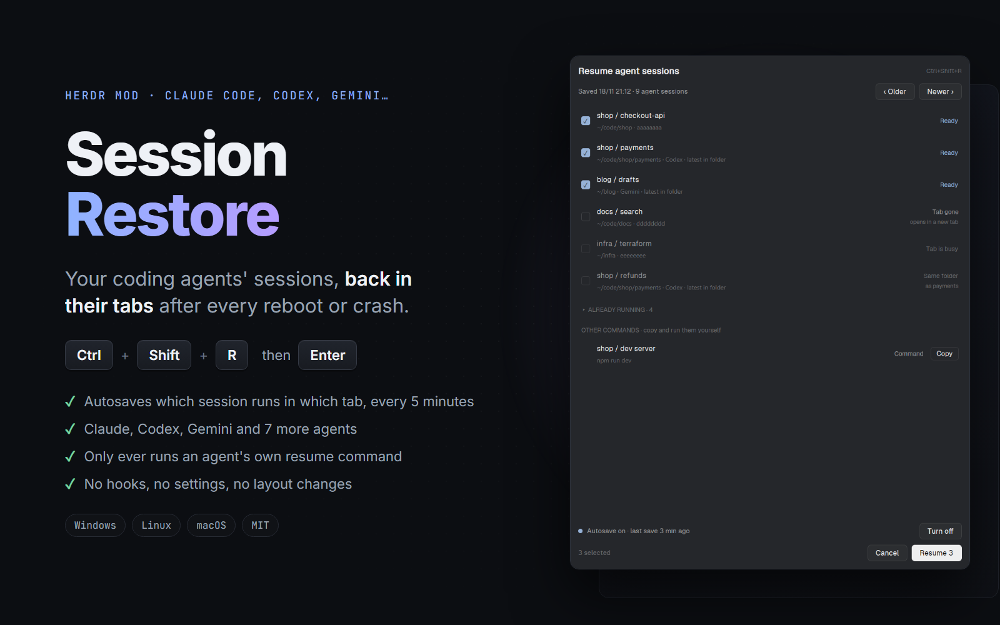

<p align="center">
  
</p>

<p align="center">
  <a href="https://herdr.dev/mods"></a>
  
  
  
  <a href="LICENSE"></a>
</p>

<p align="center">
  <b>Get your coding agents back into their <a href="https://herdr.dev">Herdr</a> tabs after a reboot or a crash.</b><br>
  One key, one popup, every session where it was.
</p>

---

herdr-core brings every space, tab and folder back after a restart, but each terminal
comes back as an empty shell: the command that ran there is never started again. This
mod saves, every 5 minutes, which coding agent runs in which terminal. After a restart
you press **Ctrl+Shift+R**, tick the sessions you want, and press **Enter**: each one
resumes in its own tab. Claude Code comes back with its exact session
(`claude --resume <id>`); other agents with their own "continue the latest session"
command, run in the folder they ran in.

## How it works

<p align="center">
  
</p>

## Supported agents

| Agent | Resumed with | What comes back |
|---|---|---|
| Claude Code | `claude --resume <id>` | that exact session |
| Codex | `codex resume --last` | the latest session in that folder |
| Gemini | `gemini --resume` | the latest session in that folder |
| Qwen | `qwen --continue` | the latest session in that folder |
| Kimi | `kimi --continue` | the latest session in that folder |
| Pi | `pi --continue` | the latest session in that folder |
| Grok | `grok --continue` | the latest session in that folder |
| Kiro | `kiro-cli chat --resume` | the latest session in that folder |
| Qoder | `qoder -c` | the latest session in that folder |
| Crush | `crush --continue` | the latest session in that folder |

Only agents whose docs say "latest" is scoped to the current folder or project are on
this list, so a row never pulls in another project's conversation. If two saved tabs ran
the same agent in one folder, only the first can resume; the other shows **Same folder**,
since both would open the same session.

Not resumed, but listed with a Copy button like any other program: OpenCode, Copilot,
Cursor, Goose and Droid (their docs don't say whether "latest" is per folder), Amp and
Aider (no "resume latest" command).

## Safe by design

| | |
|---|---|
| **Only resume commands** | Never runs anything but an agent's own resume command. Other programs that ran in a tab (say `npm run dev`) are listed with a Copy button. |
| **Never twice** | A Claude session that is already running anywhere, or another agent already running in that folder, is shown, not resumed. |
| **Never into a busy tab** | Text is only typed into a shell sitting at its prompt, checked again right before. |
| **Hands off your setup** | No hooks or settings changes in any agent, no layout changes. |
| **Nothing to install** | Windows PowerShell on Windows, plain `sh` on Linux and macOS. |

## Install

Ask your agent in Herdr:

> Read ~/.config/herdr-app/AGENTS.md, then add this mod:
> https://github.com/Dirvann/herdr-session-restore/tree/main/herdr/session-restore

Or by hand:

1. Copy `herdr/session-restore/mods/session-restore/` to `~/.config/herdr-app/mods/`.
2. Merge `herdr/session-restore/keys.json` into `~/.config/herdr-app/keys.json`
   (Ctrl+Shift+R opens the popup; Enter inside it resumes).
3. `herdr-app check ~/.config/herdr-app/mods/session-restore`

Then press **Ctrl+Shift+R** and click **Turn on autosave**. Saving only happens while
autosave is on.

## What it does to your system

- Runs `hc` and its own saver (`save.ps1` / `save.sh`, next to the mod).
- Reads Claude Code's session files in `~/.claude/sessions`.
- On Windows, records the command line of node, bun, deno, python and uv processes in
  Herdr terminals, to tell which agent an npm or Python install runs.
- Writes snapshots to `~/.herdr-sessions/auto/` (newest 50, only when something
  changed), plus `log.txt`, `last.run`, `last.error`, `last.sig`.
- **Turn on autosave** schedules the saver every 5 minutes:
  - Windows: scheduled task `HerdrSessionAutosave` (runs hidden).
  - Linux: systemd user timer `herdr-session-save.timer`, or a crontab line tagged
    `# herdr-session-restore` when there is no systemd user session.
  - macOS: LaunchAgent `dev.herdr.session-restore`.

One saver run takes about 2.7 s on Windows and 0.2 s on Linux. The popup waits for one
run when it opens and one more before it resumes.

The saver works by hand too: `sh save.sh [save|print|enable|disable|status]`, or on
Windows `powershell -File save.ps1 [-Print|-Enable|-Disable|-Status]`.

## Uninstall

Click **Turn off** in the popup (or run the saver's `disable`), delete
`~/.config/herdr-app/mods/session-restore`, remove the two keys from `keys.json`, and
delete `~/.herdr-sessions` if you don't want the snapshots.

## Status and limits

- Windows 11 (Herdr 0.1.16, herdr-core 0.1.21): saving, the popup and resuming a
  session whose Claude was killed are tested. Resuming after a real reboot is not yet.
- Codex is tested end to end on Windows: detected, shown as a row, and resumed in a new
  tab with `codex resume --last`. The other agents in the table are covered only by unit
  tests with made-up snapshots, not run for real yet. Reports welcome.
- Linux (Ubuntu): the saver and autosave are tested and the mod loads
  (`herdr-app check`); the popup has not been used in a Linux window yet.
- **macOS is untested**: the saver is written for its `ps` and `launchctl` but has never
  run on a Mac. Reports welcome.
- Only terminals on this computer; terminals on other machines (`hc machine`) are not
  saved.
- If only Claude died and its shell lived on, the session opens in a new tab rather than
  being typed into the old one: a killed Claude can leave the terminal in a state that
  garbles typed text.

## Development

```
herdr/session-restore/           the folder Herdr's gallery installs from
  RECIPE.md  preview.png  keys.json
  mods/session-restore/
    main.js      the popup
    plan.js      all decisions, pure and tested (the agent table lives here)
    save.ps1     saver for Windows
    save.sh      saver for Linux and macOS
tests/           node tests for plan.js (made-up fixtures)
docs/design.md   why it works the way it does
docs/assets/     README images; showcase.html and steps.html are their sources
```

`npm test` runs the tests (Node 20+; only needed for development). See
[CLAUDE.md](CLAUDE.md) for working on it and [docs/design.md](docs/design.md) for the
design.

## License

MIT
