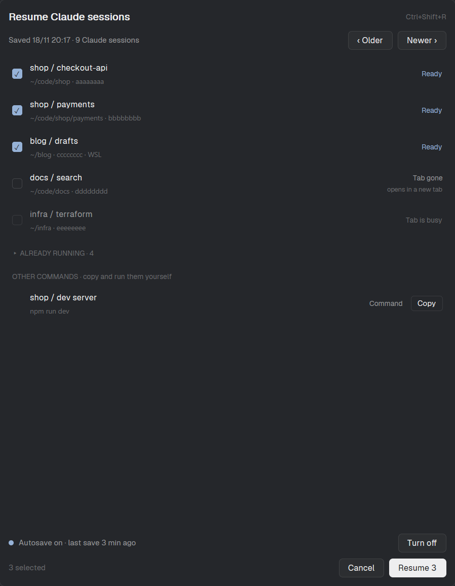

# Session restore

A popup that brings Claude Code sessions back into your Herdr tabs after a reboot or
crash. herdr-core restores every space, tab and folder, but as an empty shell; this mod
remembers which Claude session ran in which terminal and resumes the ones you tick.

**Before installing, know that it runs programs and reads files outside its folder:**
it runs `hc` and its own saver script (`save.ps1` on Windows, `save.sh` on Linux and
macOS); the saver reads Claude Code's session files in `~/.claude/sessions` and writes
snapshots to `~/.herdr-sessions`. When you click **Turn on autosave**, it registers the
saver with your system's scheduler (a scheduled task on Windows, a systemd user timer or
crontab line on Linux, a LaunchAgent on macOS). Nothing is scheduled before that click.
It never edits Claude Code's settings or hooks and never changes a layout.

## What you see

A dialog (720 wide, 75% of the window high), opened with **Ctrl+Shift+R**:

1. **Title row:** "Resume Claude sessions", the shortcut in dim text on the right.
2. **Snapshot row:** "Saved 18/11 21:22 · 15 Claude sessions" and **‹ Older** /
   **Newer ›** buttons to step through saved snapshots.
3. **Rows**, one per saved Claude session, ordered ready, gone, busy:
   checkbox, "space / tab" in the foreground color, below it the folder (home shown as
   `~`), the first 8 characters of the session id and "WSL" when it ran in WSL; on the
   right the state in small text (accent color for Ready), with a note under it
   ("opens in a new tab", "its space is gone too").
4. A folded group **▸ ALREADY RUNNING · N** (click to unfold) for sessions running now.
5. **OTHER COMMANDS · copy and run them yourself**: programs that ran in a tab (say
   `npm run dev`), each with a **Copy** button. Never run by the mod.
6. **Autosave row:** a dot (accent when on), "Autosave on · last save 3 min ago" or
   "Autosave is off: sessions are only saved while it is on", and a **Turn off** or
   **Turn on autosave** button. A failed last save shows its reason under it.
7. **Footer:** "N selected", **Cancel**, **Resume N** (primary).

Colors come from `theme()`: popover background, raised buttons, solid primary button,
accent for ticks and ready.

## How it behaves

- **States:** *Ready* (the tab is a shell at its prompt, ticked by default), *Tab gone*
  (offered as a new tab in the same space, unticked), *Tab is busy* (runs something
  else; not selectable), *Already running* (that session id runs somewhere, in Herdr or
  not; not selectable).
- **Which snapshot:** the newest one holding a session that isn't running now and whose
  tab is gone or back to an empty shell. Older/Newer change it.
- **Resume (button or Enter):** plans again first, so a tab that got busy meanwhile is
  skipped. Ready rows get one typed line in their shell (`cd /d "…" && claude --resume
  <id>` in cmd, `Set-Location -LiteralPath '…'; claude --resume <id>` in PowerShell,
  `cd -- '…' && claude --resume <id>` in bash/zsh/sh, own forms for fish and nu, a
  `wsl.exe -d <distro> …` line for WSL). If the shell is the same process as when the
  snapshot was saved (only Claude died), it opens a new tab instead, because a killed
  Claude can leave the terminal in bracketed-paste mode, which garbles typed text.
  Gone rows open `claude --resume <id>` as a new tab in their space. A toast reports
  what was resumed and what was skipped; the dialog closes.
- **Escape / Cancel** closes it. Clicking a row toggles it.

## Built from

- `mods/session-restore/` with `mod.json`
  `{ "place": "none", "title": "Resume sessions", "overlay": { "kind": "dialog", "width": 720, "height": 0.75 } }`.
- `keys.json`: global `ctrl-shift-r` → `mod.open:session-restore`; section
  `mod:session-restore` `enter` → `session-restore.resume` (the mod reads it with
  `nextCommand()`).
- `main.js` (the dialog), `plan.js` (pure logic, no imports: reads snapshots, finds the
  Claude process under each terminal's root pid by matching a session file's
  `startedAt` to the process start, decides states and resume lines).
- `herdr` functions: `exec` (the saver), `hc(["send", …])`, `run("tab.new", …)`,
  `readTextFile`, `spaces()`, `appHome()`, `home()`, `window().platform`, `theme()`,
  `notify`, `props`, `closeOverlay`, `checking`, `nextCommand`; `fs/promises.readdir`;
  `cx.write_to_clipboard` for Copy.
- Saver, same subcommands on every system: save (default), `print` (fresh snapshot to
  stdout, the popup's view of "now"), `enable`, `disable`, `status`
  (`{"enabled","lastRun","lastError"}`). Windows: `powershell.exe -File save.ps1
  [-Print|-Enable|-Disable|-Status]`, Windows PowerShell 5.1. Linux/macOS: `sh save.sh
  [save|print|enable|disable|status]`, POSIX sh. Snapshots:
  `~/.herdr-sessions/auto/<yyyyMMdd-HHmmss>.json` with `version: 2`, raw `hc ls` and
  `hc get` output, the process list and live Claude session files; written only when
  something changed; newest 50 kept.

## Watch out

- Claude Code's `procStart` differs per OS; match on `startedAt` (a few seconds after the
  process starts) within −5 s … +120 s, or a crash's leftover session file whose pid
  was reused will look like a live session.
- `hc send` always presses Enter, so other commands are Copy-only.
- Only this computer's terminals, only Claude Code. Terminals without a `herdr.space`
  label (hidden workers, Herdr mobile) are skipped.
- `herdr-app check` runs `init()` for real: the mod skips all `exec` while `checking()`.
- macOS is untested (written for BSD `ps` and `launchctl`, never run on a Mac).
- Space and tab names come from hc's `where` label ("space / tab"), split on the last
  " / "; a tab name containing " / " splits wrong.
